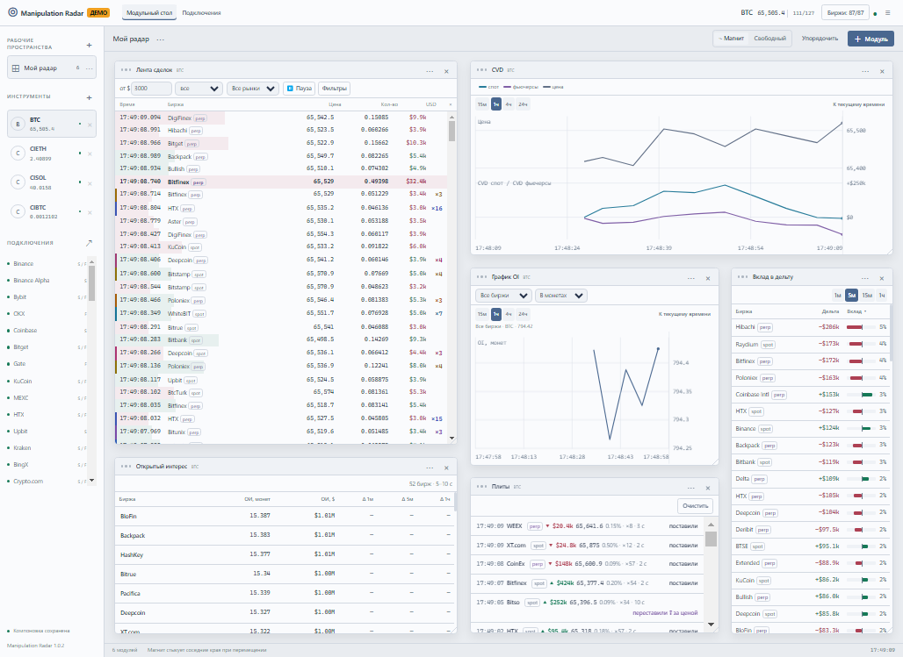

# Manipulation Radar

**Удобный монитор рыночных данных в помощь скальперу.**

Отслеживайте сделки, крупные заявки и активность бирж рядом с привычным торговым
терминалом. Manipulation Radar помогает сравнивать спот и фьючерсы, следить за CVD,
открытым интересом и вкладом площадок в дельту. Добавляйте нужные модули, выбирайте
источники данных и сохраняйте отдельные рабочие пространства под разные задачи.

**[Скачать для Windows](https://github.com/ksen0v/ExchangeAlgoDiscovery/releases/latest/download/ManipulationRadar-Setup.exe)**
· [Все выпуски](https://github.com/ksen0v/ExchangeAlgoDiscovery/releases)
· [Сообщить о проблеме](https://github.com/ksen0v/ExchangeAlgoDiscovery/issues/new)

*Пример рабочего пространства. На изображении показаны демонстрационные данные.*

## Что умеет приложение

| Возможность | Для чего нужна |
| --- | --- |
| **Лента сделок** | Показывает время, площадку, сторону, цену, количество и сумму сделки. Помогает наблюдать за потоком покупок и продаж. |
| **CVD спота и фьючерсов** | Показывает, как накапливается разница между объёмами покупок и продаж на каждом рынке. |
| **Открытый интерес — OI** | Показывает объём открытых фьючерсных контрактов, его изменение и историю по доступным биржам или по их сумме. |
| **Вклад в дельту** | Позволяет сравнить покупки, продажи и чистую дельту отдельных площадок за выбранный период. |
| **Биржи** | Собирает цены, объёмы и активность подключённых площадок в одном месте. |
| **Плиты** | Показывает события крупных заявок рядом с ценой: появление, перемещение, снятие и исполнение. |
| **Алерты** | Сообщает о событиях, подходящих под выбранные условия. Есть звук, уведомления Windows и отправка в Telegram. |
| **Оверлеи** | Выводит ленту и аналитику отдельными окнами поверх вашего торгового терминала. |

Приложение предназначено для наблюдения и анализа. Ордера и позиции вы открываете
в своём торговом терминале.

## Установка и первый запуск

Нужны **Windows 10 или Windows 11, 64-разрядная система** и подключение к интернету.
Доступность данных зависит от выбранной биржи и её доступности из вашей сети.

1. [Скачайте установщик последней версии](https://github.com/ksen0v/ExchangeAlgoDiscovery/releases/latest/download/ManipulationRadar-Setup.exe).
2. Запустите **ManipulationRadar-Setup.exe** и завершите установку.
3. Откройте **Manipulation Radar** из меню «Пуск» или с созданного ярлыка.
4. Нажмите **«+»** рядом с **«Инструменты»** слева и добавьте тикер монеты.
5. Откройте **«Биржи»**, выберите нужные площадки и сохраните выбор.

Для просмотра публичных рыночных данных вводить торговые ключи от бирж не требуется.

Монета появляется в списке сразу после добавления. Под тикером отображается
подготовка и подключение бирж; данные появляются по мере готовности площадок.
Если сохранить монету не удалось, в её строке будет ошибка и кнопка повтора.

В первом рабочем пространстве **«Мой радар»** уже размещены лента, CVD, график OI,
таблица открытого интереса, вклад в дельту и плиты. Их можно сразу настроить или
собрать собственный набор.

## Соберите свой рабочий стол

### Модули

Нажмите **«+ Модуль»** и выберите, что разместить на экране. Можно добавить несколько
экземпляров одного типа: например, две ленты с разными фильтрами или несколько
графиков OI для разных бирж.

- **Перемещение:** потяните модуль за заголовок.
- **Размер:** потяните за край или угол модуля.
- **Удаление:** нажмите **«×»** в заголовке.
- **Название и копия:** откройте меню **«⋯»** модуля.

Если плиты, алерты или другие панели вам не нужны, их можно удалить и добавить
обратно позднее через **«+ Модуль»**.

### Два режима размещения

- **Магнит** — соседние края притягиваются при сближении. Удобно для ровной компоновки.
- **Свободный** — вы сами задаёте положение модулей и расстояние между ними.

Кнопка **«Упорядочить»** распределяет модули по экрану. В режиме магнита панели
размещаются вплотную. При перемещении можно удерживать **Alt**, чтобы временно
отключить притягивание.

### Рабочие пространства

Нажмите **«+»** рядом с заголовком **«Рабочие пространства»** в боковой панели.
Укажите название и добавьте нужные модули. Например, одно пространство можно
выделить под ленты, другое — под сравнение открытого интереса.

Через **«⋯»** рядом с названием пространство можно переименовать, скопировать или
удалить. Фиксированного ограничения на количество пространств нет.

Состав модулей, их положение, размеры, режим размещения и настройки сохраняются
после перезапуска. Выбирайте монету в списке **«Инструменты»** слева: все модули
стола показывают выбранный инструмент. Переключение пространства меняет компоновку.

На небольших окнах панели располагаются в прокручиваемых колонках. При возврате
к широкому окну восстанавливается сохранённая компоновка.

## Настройка ленты и бирж

У каждой ленты свои настройки:

- минимальная сумма сделки;
- все стороны, только покупки или только продажи;
- все рынки, только спот или только фьючерсы;
- выбранные площадки;
- собственные пороги размера сделок для каждой биржи, отдельно для спота и фьючерсов;
- пауза обновления.

Кнопка **«Фильтры»** в ленте открывает таблицу порогов по площадкам. Если поле
оставить пустым, действует общий порог этой ленты. Можно поставить как более
высокое, так и более низкое значение.

**Выбор источников и фильтры ленты решают разные задачи.** Кнопка **«Биржи»**
в верхней панели определяет, какие площадки приложение отслеживает для монеты.
Настройки внутри ленты определяют, какие сделки вы видите в этом модуле.

Выбор бирж запоминается отдельно для каждой монеты. Есть поиск, выбор всех
площадок и снятие всех отметок. Подключайте те биржи, которые нужны вам для работы.

## Графики CVD и открытого интереса

На графиках доступны периоды **15 минут, 1 час, 4 часа и 24 часа**.

- Тяните график мышью, чтобы перейти к другому участку истории.
- Используйте колесо мыши для изменения масштаба по времени.
- Тяните правую шкалу, чтобы изменить масштаб значений.
- Наведите курсор на линию для просмотра значений в выбранный момент.
- Нажмите **«К текущему времени»** или дважды щёлкните по графику, чтобы вернуться к последним данным.

На каждом графике OI можно независимо выбрать биржу или **«Все биржи»**, а также
отображение в монетах или долларах. Нажатие на название биржи в таблице OI открывает
её график на рабочем столе.

История накапливается отдельно для каждой добавленной монеты, в пределах суток.
Переключение между монетами сохраняет накопленные CVD и OI. После удаления
инструмента из списка или перезапуска приложения история начинает собираться заново.

## Оверлеи, темы и уведомления

**Оверлеи** позволяют держать любой модуль поверх другого терминала. Нажмите
**«⋯»** в заголовке модуля или щёлкните по нему правой кнопкой мыши и выберите
**«Разместить оверлей»**. Оверлей запоминает монету и настройки модуля: можно
переключить стол на ETH, пока поверх терминала остаётся лента BTC.

У оверлеев можно менять положение и размер, а фильтры и графики настраиваются
так же, как на столе. В **«⋯ → Настройки оверлея»** выберите непрозрачный или
прозрачный фон и настройте его плотность. Прозрачность меняет только фон;
текст и линии остаются чёткими. Эти настройки сохраняются для каждого окна.

Режим **«Сквозные клики»** включается отдельно для каждого оверлея. При включении
фон автоматически становится прозрачным, и нажатия по содержимому проходят
в терминал. Заголовок, **«⋯»**, кнопка разблокировки и закрытия остаются доступными.
Выключить режим можно прямо в оверлее, горячей клавишей или через
**«☰ → Отключить сквозные клики у всех»**. Выбор непрозрачного фона также отключает
сквозные клики.

По умолчанию:

| Сочетание | Действие |
| --- | --- |
| **Ctrl + Alt + T** | Показать или скрыть оверлеи |
| **Ctrl + Alt + L** | Включить или отключить сквозные клики |

Горячие клавиши и уведомления Windows настраиваются в **«☰ → Подключение и горячие клавиши»**.
Там же можно указать данные своего Telegram-бота и чата. Отправка алертов
в Telegram включается в настройках приложения.

Кнопка **«Светлая тема» / «Тёмная тема»** меняет оформление рабочего стола и оверлеев.
Переключение темы и звуковые оповещения доступны в меню **«☰»**.

## Обновления

Откройте **«☰ → Проверить обновления»** и, если доступна новая версия, нажмите
**«Обновить и перезапустить»**. Размер загрузки показывается заранее.

Обычно загружаются только необходимые изменения. Для некоторых крупных обновлений
может понадобиться полный установщик. Настройки приложения и рабочие пространства
при обновлении сохраняются.

Последний установщик всегда доступен на [странице выпусков](https://github.com/ksen0v/ExchangeAlgoDiscovery/releases/latest).

## Частые вопросы

### Какой файл скачивать на странице выпуска?

Для установки выберите **ManipulationRadar-Setup.exe**. Остальные вложения
приложение использует при обновлении; отдельно открывать их не нужно.

### Нужен ли аккаунт GitHub или подключённый биржевой аккаунт?

Для скачивания программы и просмотра публичных рыночных данных аккаунт GitHub
и торговые ключи бирж не требуются.

### Можно ли смотреть несколько монет?

Да. Добавляйте монеты через **«+»** рядом со списком **«Инструменты»** слева.
Фиксированного ограничения на их количество нет; все аналитические модули
доступны для каждой монеты. Нажмите на тикер, чтобы переключить стол.
У каждой монеты свой выбор бирж. Ненужный инструмент можно убрать кнопкой **«×»**:
его потоки и оверлеи будут закрыты. Чем больше монет и бирж включено,
тем больше ресурсов требуется для их наблюдения.

### Почему некоторые биржи отсутствуют в таблице OI?

Монета может не торговаться на этой площадке, открытый интерес может быть
недоступен или данные ещё не поступили. В таблице показываются площадки,
от которых уже получены данные OI выбранной монеты. Устаревшие значения
не включаются в общий открытый интерес.

### Почему график начинается с недавнего времени или содержит разрывы?

Доступная глубина истории зависит от времени наблюдения за монетой. Разрывы
могут появляться при пропусках данных; у общего OI — также при изменении
набора площадок, участвующих в сумме.

### Почему лента отличается от ленты в другом терминале?

Проверьте, совпадают ли монета, биржа, спот или фьючерсы, сторона сделки и порог
размера. На отображение также влияют объединение исполнений и время обновления.

### Что означает знак «≈» у сделки?

Сторона такой сделки определена приблизительно. В частности, у Binance Alpha
при отсутствии точных данных она оценивается по изменению цены. Для этих сделок
совпадение стороны с другим терминалом не гарантируется.

### Что означает подсветка повторяющихся размеров?

Приложение выделяет серии сделок похожего размера и стороны. Отметка помогает
заметить повторения; она сама по себе не подтверждает работу конкретного бота.

### Влияет ли фильтр крупных сделок на CVD и дельту?

Фильтр определяет содержимое выбранной ленты. Рыночная аналитика учитывает
сделки независимо от порога отображения в этом модуле.

### Зачем нужен демонстрационный режим?

Он позволяет познакомиться с интерфейсом на учебных данных. Пометка **«ДЕМО»**
в верхней панели означает, что показанные сделки и показатели демонстрационные.
Переключение режима доступно в **«Меню → Подключение…»**.

### Что делать, если сделки не появляются?

Проверьте выбранную монету, включённые биржи, паузу и фильтры нужной ленты.
Затем откройте **«Подключения»**: там видны состояние площадок и причины
отсутствия данных. Для редких монет сделок может быть мало, особенно при высоком
пороге суммы.

### Как уменьшить нагрузку на компьютер?

Включите только нужные биржи, удалите лишние модули и закройте ненужные оверлеи.
Количество площадок и одновременно открытых окон влияет на нагрузку.

### Как сохранить копию настроек или перенести их на другой компьютер?

Откройте **«Меню → Папка данных»**, закройте приложение и сохраните копию
содержимого этой папки. Для переноса сначала установите программу на другом
компьютере, откройте его папку данных, закройте приложение и восстановите туда
сохранённые файлы.

### Почему Windows предупреждает об установщике?

Установщик пока не имеет цифровой подписи издателя. Загружайте программу
со [страницы выпусков этого репозитория](https://github.com/ksen0v/ExchangeAlgoDiscovery/releases).
Если защита Windows мешает установке, приложите текст уведомления к обращению
в поддержку.

### Есть ли версия для macOS или Linux?

В текущих выпусках распространяется приложение для Windows.

## Вопросы и обратная связь

Если вы нашли ошибку или хотите предложить улучшение,
[создайте обращение](https://github.com/ksen0v/ExchangeAlgoDiscovery/issues/new).
Укажите версию приложения, версию Windows, монету и биржу, название модуля
и действия, после которых возникла проблема. При необходимости приложите скриншот.

Номер установленной версии указан в заголовке окна и в разделе **«Обновления…»**.
